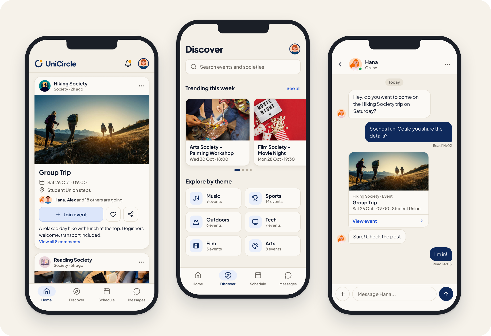
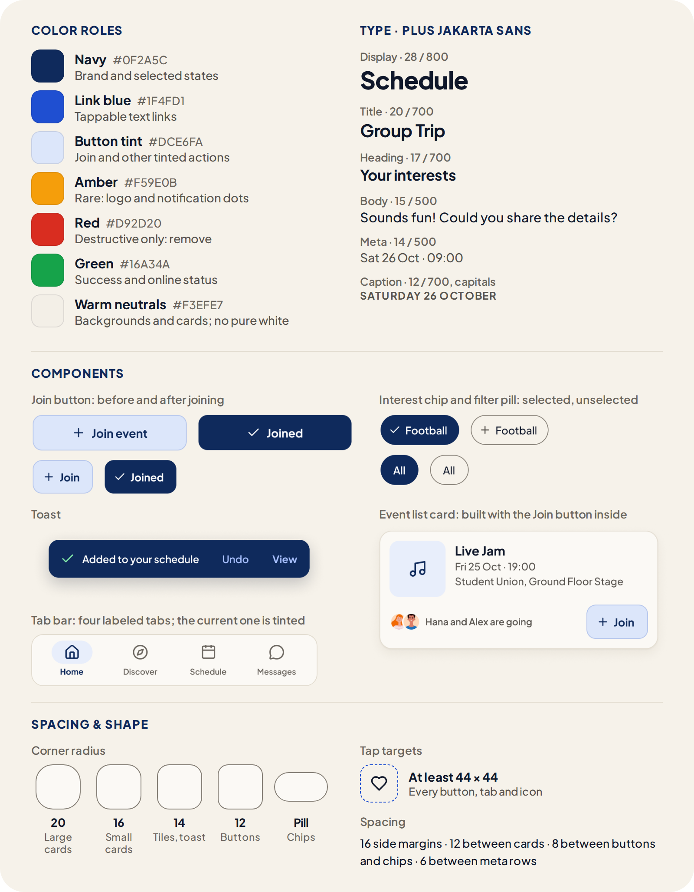

# UniCircle

**A mobile app that supports social connection and belonging at university by helping students find on-campus events and go with friends.**

**[View prototype (Figma)](https://www.figma.com/proto/j4RMidHrYSRu5FzZ6YrCt8/UniCircle?node-id=1-3&p=f&viewport=103%2C94%2C0.34&t=OrepHrMIzofegUjS-1&scaling=scale-down&content-scaling=fixed&starting-point-node-id=1%3A3&show-proto-sidebar=1&page-id=0%3A1)**

**[Read the case study (PDF)](Ayoub-Aldawood-UniCircle-Case-Study.pdf)**

<em>Selected screens: Home, Discover, and Chat</em>

| Role | Methods | Tools |
|---|---|---|
| Research, design, prototyping and testing | Survey (10 students); think-aloud usability test (4 students) | Figma, Google Forms |

Starting university means building a social life from scratch, but news of events is scattered and going alone can be daunting. To address this, I surveyed 10 students, designed and prototyped UniCircle in Figma, and ran a think-aloud usability test with four students. The test revealed five issues, two of them major; the final design addresses each one and adds a design system that meets WCAG AA contrast.

## Design System

Built from 20 color variables, 20 text styles and reusable components, with fixed rules for spacing, corner radius and tap targets.

<em>Design system: color roles, type scale, components, and spacing &amp; shape</em>

## What's in the Case Study

- Final design, annotated screen by screen
- Design system
- Problem and user research
- Wireframes and first prototype
- Usability testing and findings
- Redesign decisions
- Next steps
- Reflection

## Skills Demonstrated

User research · Usability testing · Interaction design · Information architecture · Visual design · Design systems · Accessibility (WCAG) · Prototyping · Figma
